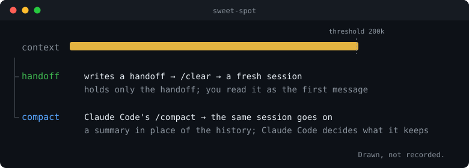

<p align="center">
  <picture>
    <source media="(prefers-color-scheme: dark)" srcset="docs/images/banner-dark.svg">
    
  </picture>
</p>

<p align="center">
  <b>One job: keep your context in the sweet spot.</b><br>
  Not so long that answers get less reliable and every call re-reads a mountain.
</p>

<p align="center">
  <a href="https://github.com/muellerei/sweet-spot/actions/workflows/check.yml"></a>
  <a href="LICENSE"></a>
</p>

<p align="center">
  <a href="#install">Install</a> · <a href="#why">Why</a> · <a href="#what-it-does">What it does</a> · <a href="#handoff-or-compact">Handoff or compact</a> · <a href="#what-it-can-reach">What it can reach</a> · <a href="#settings">Settings</a> · <a href="#limits">Limits</a> · <a href="CHANGELOG.md">Changelog</a> · <a href="CONTRIBUTING.md">Contributing</a>
</p>

sweet-spot hands a long Claude Code session over before the context gets too big, at a moment when that is safe: to a fresh session that starts from a handoff, or by Claude Code's own `/compact`. "Handover" is the word for all of these. It is a Claude Code mod (a plugin of function hooks).



*Drawn, not recorded: an illustration of the sequence, looping.*

**Built to be safe**

- **Only at a pause.** Never in the middle of a turn, never from a subagent.
- **Waits for running work.** A subagent, a background task or a timer holds it back.
- **Typing is not lost.** What you type during a handover is held and goes in when it is done.
- **Writes nothing.** No files, no network, no processes of its own.

## Install

Developed against Claude Code 2.1.296; older versions are not tested, and versions before 2.1.271 cannot load the mod at all (see [Settings](#settings)). Run inside Claude Code:

```text
/plugin marketplace add muellerei/sweet-spot
/plugin install sweet-spot@muellerei-sweet-spot
/reload-plugins
```

That is all the setup there is. Work until the context passes 200k tokens, and at the end of an answer you see:

```text
handing over now, context 205000 tokens
handed over, the fresh session carries on from the handoff
```

By default the mod writes the handoff itself with a built-in prompt, clears the session and starts the fresh one with it; if that fails, it compacts the session instead. `~/.claude/sweet-spot/handoff-prompt.md` replaces that prompt. `handoff_method` and `handoff_fallback` choose the ways: Claude Code's own `/compact`, the mod's handoff, or a handoff command of your own. To watch first, turn `dry_run` on in `/config`: then it only says when it would hand over. See [Settings](#settings).

Ideas, questions and a quick "works on my setup" are all welcome: [CONTRIBUTING.md](CONTRIBUTING.md).

## Why

The sweet spot is the range where the context is big enough to hold the work and still small enough to be cheap and reliable.



- **Cost.** Every call re-reads the whole context. Measured over real sessions, most of the cost came from calls on more than 200k tokens.
- **Reliability.** "As token count grows, accuracy and recall degrade" ([Anthropic](https://platform.claude.com/docs/en/build-with-claude/context-windows)). An independent test of 18 models found the same ([Chroma](https://www.trychroma.com/research/context-rot)).

A fresh session starts at 62k to 98k tokens in real handovers. Nobody publishes where the line lies, and the picture is a sketch. The default of `200000` comes from the cost measurement. The mod does not claim that a fresh session answers better, only that a long one costs more.

## What it does

At the end of an answer it looks at the context size. Past the threshold, and when nothing else is going on, it hands over. By default that means it asks for a handoff, clears the session and submits the text of the handoff file, not its path, as the first message of the new one. With `/compact` as the way, the session stays and only gets smaller; nothing is cleared or submitted.

- **Only at a pause.** It acts when an answer is finished, never in the middle of a turn and never from a subagent. A turn that ended with an error, a refusal or Esc is no pause.
- **Not now, if you say so.** In the middle of something? `/sweet-spot later 50k` moves this one handover back: the mod hands over once the context has grown 50k tokens past where it is now. The next handover uses your threshold again. It never goes past the emergency brake and never brings a handover forward. With no number it takes `later_tokens`.
- **It waits for running work.** While a subagent, a background task or a one-shot timer is running, it postpones, because a handoff written now could not hold that work's result, and the result would come into a fresh session that does not know what it was for. It says so once ("handoff postponed, a subagent is running, context 201293 tokens"); it does not repeat the line at every stop. It acts at the first pause after the last one has finished (measured: the answer after the last subagent ended handed over). Past an emergency brake (150k above the threshold, never beyond 90 percent of the window) it goes ahead anyway and says so.
- **You choose the way.** `handoff_method` is the main way, `handoff_fallback` the one tried when the main way fails before it changed the session, and the change is said with its reason. The ways: the mod writes the handoff itself with a built-in prompt (`internal-handoff`, the default); Claude Code's own `/compact` (`builtin-compact`, the default fallback); or your own command, run as a turn of its own, whose file the mod reads (`external-command`, needs `handoff_command`). If Claude Code refuses the compact (it does in a headless `-p` or SDK session) or a hook vetoes it, the fallback takes over; if you press Esc during it, nothing else hands over.
- **A compact that is not enough is not repeated.** If the context is still above the threshold right after a compact (at the first tool call of the next turn, or its pause), the next time the fallback takes over; with no fallback, the mod says so once and leaves the session alone until a pause is below the threshold again.
- **Typing is held, not lost.** What you type while a handover runs is held and goes in when it is done: into the fresh session with the handoff, or into the compacted session. If submitting the message fails, `/sweet-spot redeliver` is the way out: it submits it again.
- **Report only, if you want.** With `dry_run` on it only says "would hand over now" and does nothing.
- **Bad settings are refused, not repaired.** A threshold so low that every fresh session would trigger the next handover is rejected with the reason, and the mod stays off.

What happens to what you type while a handoff runs, and what `redeliver` is for:



*Drawn, not recorded: an illustration of the sequence, looping.*

And the questions the mod asks at every pause, in this order. The first one that says stop ends the check:



*Drawn, not recorded: an illustration of the sequence, looping.*

## Handoff or compact

Both ways bring the context down. They differ in what the session holds afterwards.



| | Handoff (default) | Compact |
| --- | --- | --- |
| Afterwards | A fresh session that holds only the handoff | The same session, with Claude Code's summary in place of the history |
| What it keeps | What the handoff prompt asks for; `~/.claude/sweet-spot/handoff-prompt.md` replaces it | What Claude Code's `/compact` keeps; the mod has no say in it |
| Can you read it | Yes, it is the first message of the fresh session | No file; the summary goes straight into the session |
| Time, measured | From the end of the answer to the fresh session's first message: 20 to 34 s with your own command at 202k to 224k tokens. With the built-in prompt 15 to 21 s, measured when it stood in for a missing command | The compact itself: about 15 s at 65k tokens, 56.5 s at 408k; it grows with the context |
| Context after, measured | At the start of the fresh session: 62k to 98k tokens with your own command, 31k once with the built-in prompt | 130k at the first pause after a compact at 408k; that pause already holds the next turn |

`handoff_method` picks the way and `handoff_fallback` the one tried when it fails. A handoff command of your own (`external-command`) goes the handoff way: its file starts the fresh session. See [Settings](#settings).

## What it can reach

- **Reads:** your handoff file, `~/.claude/sweet-spot/handoff-prompt.md` if you made one, and a listing of the temp directory to find a handoff the answer did not name, or of the folder of the file it does name, and the environment variables `HOME` and `TMPDIR`, to find those two places.
- **Writes:** nothing. The message waiting to be delivered lives in the mod's store in Claude Code, which `/clear` does not touch.
- **Network, own processes:** none. The model call that writes the handoff runs through Claude Code, and so does the compact.

To check this against the code yourself:

```sh
claude plugin validate .
```

It lists every call the hooks make and every environment variable they read.

## How it differs

There are several context mods. They fall into a few approaches, and this table compares features, not projects. It reflects the code of the context mods read in October 2026 and is meant as a map, not a ranking. Only features this version has are listed; corrections are welcome.

| | Compacts in place | Hands over (typical) | sweet-spot |
| --- | --- | --- | --- |
| New session instead of a summary in the same one | no | yes | yes, or a compact if you choose |
| Acts only when an answer is finished | mostly | mostly | yes |
| Waits for subagents and background work | some | some | yes |
| Report-only mode before it acts | one, as its default | only a manual dry run | yes, a setting |
| Falls back to a second way if the first fails | rare | rare | yes |
| Writes into your project | rarely | often, or by asking Claude to | never |

## What it does not do

No memory, no rules, no panel or status line. It has no summarizer of its own: when it compacts, it starts Claude Code's own `/compact`. Those belong in other tools. The first version also has no countdown or button before it acts, no cache keep-warm and no log file; the [CHANGELOG](CHANGELOG.md) lists them under "Not in this version".

## Settings

In the `/config` menu under sweet-spot.

| Setting             | Default            | What it does                                                                                                                                                                                                                   |
| ------------------- | ------------------ | ------------------------------------------------------------------------------------------------------------------------------------------------------------------------------------------------------------------------------ |
| `threshold`         | `200000`           | Context size in tokens at which it hands over. Values below `130000` are refused. On a small window it is lowered to 80 percent of the window.                                                                                 |
| `dry_run`           | off                | Only say that a handoff would happen, and do nothing. Turn on to watch what the mod would do before it acts.                                                                                                                   |
| `min_gap_minutes`   | `10`               | Least time between two attempts. `0` turns the whole gap off.                                                                                                                                                                  |
| `min_gap_turns`     | `5`                | Least number of turns between two attempts. `0` turns the whole gap off.                                                                                                                                                       |
| `later_tokens`      | `25000`            | How far `/sweet-spot later` moves the next handover back when you give it no number, in tokens.                                                                                                                                |
| `handoff_method`    | `internal-handoff` | How the session is handed over. `internal-handoff`: the mod writes a handoff and starts a fresh session with it. `builtin-compact`: Claude Code's own `/compact`, the session stays. `external-command`: your own command.     |
| `handoff_fallback`  | `builtin-compact`  | Used when the main method fails before it changed the session: any of the three, or `none` for no second try (the mod says why). The same value as `handoff_method` means no fallback.                                         |
| `handoff_command`   | empty              | Only used with `external-command` (advanced). Name of your own handoff command, without the slash. `external-command` with no command here switches the mod off and says why.                                                  |

The two ways are choices in `/config`, so they cannot be mistyped; an unknown value is refused. Does not load before Claude Code 2.1.271: the host rejects a mod with fixed choices in an older version ("If you declare `options` on any field, users on Claude Code versions before v2.1.271 can't load the plugin", Claude Code plugin reference, section "Limit a field to fixed options"). Examples:

- Compact only: `handoff_method` `builtin-compact`, `handoff_fallback` `none`.
- Compact when it works, otherwise a handoff: `builtin-compact` and `internal-handoff`.
- Only your own command: `external-command` and `none`, with `handoff_command` set.

The gap ends after the minutes **or** the turns, whichever comes first. Both are starting points; raise them if attempts come too close together.

A change in `/config` takes effect at once: the host reloads the mod, which starts from a clean state, so the minimum gap, the `redeliver` pointer and a `later` are forgotten. A reload while a handoff is running (the seconds after the mod decides to hand over, see [Handoff or compact](#handoff-or-compact)) ends that handoff without a message, so leave the settings alone during that time.

## Commands

The mod has one command, `/sweet-spot`, and the word after it says what it does. It runs at once, also while an answer is still running.

| Command                       | What it does                                                                                                                                                                                       |
| ----------------------------- | -------------------------------------------------------------------------------------------------------------------------------------------------------------------------------------------------- |
| `/sweet-spot later [tokens]`  | Moves the next handover back until the context has grown that many tokens past where it is now (`50000` or `50k`; with no number, `later_tokens`). It says the value it hands over at, or why not. |
| `/sweet-spot redeliver`       | Submits again the first message of a handoff that did not reach the fresh session.                                                                                                                 |

## Limits

- It waits only for what the host reports as a subagent, a background task or a one-shot timer. Work the host does not report, it cannot see.
- A reason for postponing is said once, not at every stop. When the reason changes, or the wait ends and returns, it is said again.
- A dry run counts as an attempt and starts the minimum gap, so you do not get a new "would hand over" at every turn.
- `redeliver` submits only into the fresh session that `/clear` made, and says so if you are in another one (after a `/resume`, say). Only a handoff that failed at the submit can be redelivered, and only until the mod is reloaded; after a reload it says "nothing to redeliver". It does not run while an answer is still running: it says so, and you try again when the answer is done.
- `later` holds only for the next handover in this session; anything that shrinks the context (a compact, yours too, or `/clear`), a reload or a change in `/config` forget it. The mod gives no warning before it hands over yet, so say `later` before the answer that crosses the threshold has ended, not after.
- While a handoff runs, a message with an attachment is turned away, because the mod cannot reach the attachment. Send it again afterwards. Slash commands still run.
- Claude Code starts its turn counter over after `/clear`, while the mod still remembers the turn of the last attempt. The turn part of the gap therefore ends only once the new counter is `min_gap_turns` past the old number; the time part is what ends it sooner.
- A handoff command of your own needs permission to run a shell command and to write a file in the temp directory. Without an allow rule for them, Claude Code asks, and the question holds the handoff. The mod says nothing while it waits; after 5 minutes it gives up on the command and falls back. Answering the question ends the wait sooner. Esc or "No" at the question cancels the handover if the command then writes no file; a rule that denies the call falls back to the other way. Allow `Bash` and `Write` for the temp directory if you want it unattended.

### If a handoff does not happen

Start Claude Code with `SWEET_SPOT_LOG_LEVEL=info claude`. At every end of an answer the mod then writes a pause line to the transcript that shows what it saw and what it decided ("0 background tasks, 0 timers, 0 subagents", "decided none"). Please add those lines to a bug report. If a handoff goes wrong after it has started, the lines vanish from the window with its `/clear`; start with `claude --debug-file <path>` as well and attach the lines from that file. Instead of setting the variable at the start, you can put it in the `env` block of a settings file such as `.claude/settings.local.json`; a change there counts from the next turn, without a restart. It is not a setting of the mod and has no place in `/config`. The levels are explained in [CONTRIBUTING.md](CONTRIBUTING.md#debugging).

## Try it

1. Turn `dry_run` on and work until the context passes the threshold. You get one line, "would hand over now", and nothing else happens.
2. Pass the threshold while a subagent runs: it says once "handoff postponed, a subagent is running" and hands over at the first pause after the subagent has finished.
3. Turn `dry_run` off and let an answer finish past the threshold: the session hands over to a fresh one that starts with the handoff.

For a quick test, set `threshold` to `130000`, the lowest value it accepts.

## Thanks

The pause detection, the handoff the model writes, the held typing and `redeliver` come from [ctx-handoff](https://github.com/cablate/ctx-handoff-mod) (MIT). Running your own `/handoff` command and reading the file it wrote follows [auto-handoff by Spardutti](https://github.com/Spardutti/claude-mods) (MIT). Both notices are in [NOTICE](NOTICE). Thank you both.

## Support

Report problems and ideas as issues at https://github.com/muellerei/sweet-spot/issues. Say which Claude Code version and surface you use, and what the line in the session said.
